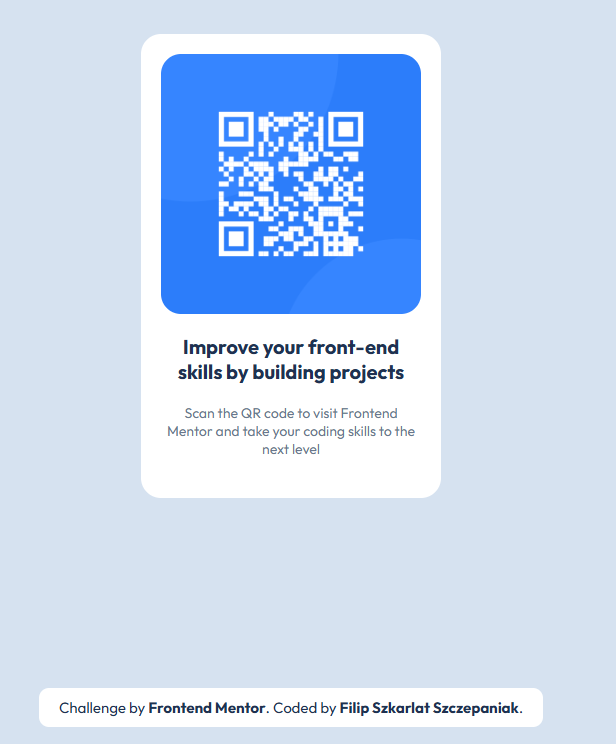

# Frontend Mentor - QR code component solution

This is a solution to the [QR code component challenge on Frontend Mentor](https://www.frontendmentor.io/challenges/qr-code-component-iux_sIO_H). Frontend Mentor challenges help you improve your coding skills by building realistic projects. 

## Table of contents

- [Overview](#overview)
  - [Screenshot](#screenshot)
  - [Links](#links)
- [My process](#my-process)
  - [Built with](#built-with)
  - [What I learned](#what-i-learned)
  - [Continued development](#continued-development)
  - [Useful resources](#useful-resources)
  - [AI Collaboration](#ai-collaboration)
- [Author](#author)
- [Acknowledgments](#acknowledgments)

## Overview

### Screenshot

### Links

- Live Site URL: https://qr-code-component-by-filip.netlify.app

### Built with

- Semantic HTML5 markup
- CSS custom properties
- Flexbox
- Mobile-first workflow

## Author

- Website - [Filip Szkarlat Szczepaniak](https://filipszkarlatportfolio.netlify.app)
- Frontend Mentor - [@FilipSzkarlat](https://www.frontendmentor.io/profile/FilipSzkarlat)
- LinkedIn - [@FilipSzkarlatSzczepaniak](https://www.linkedin.com/in/filip-szkarlat-szczepaniak/?isSelfProfile=true)
